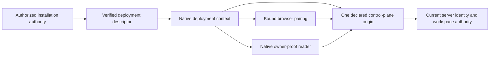

# Customer-controlled deployment origin and identity — proposed v1 contract

**A9 architecture foundation; design recommendation only.** No runtime migration, new endpoint, trust enrollment, credential operation or deployment is implemented or authorized here. Core Governance and all master acceptance gates remain open. The current vendor mode must remain intact until a separately reviewed migration has genuine qualification evidence.

## Purpose and current source

A customer installation needs one understandable answer to “which deployment owns this sign-in, workspace and action?” A URL setting, workspace label or source hash cannot answer that question alone. This contract separates deployment identity, transport destination and current user authority. It follows A9's requirement for customer-controlled/offline operation without removing authentication, independent approvals, provider restrictions or audit/recovery controls.

| Current seam | Observed source behavior | Consequence for A9 |
| --- | --- | --- |
| Native buffered API | Rust HTTP constructs the fixed public origin plus an API path, filters methods/headers and disables redirects. | Do not assume a saved endpoint changes this transport. |
| Native streaming API | Production streams select the same product origin; a loopback alternative exists only in unit-test compilation. | A configurable browser client is not customer-hosted streaming support. |
| Webview fetch bridge | The bridge installs at desktop startup and restricts packaged requests to the fixed product origin/API paths. Browser-development fallback is a different runtime. | All participating paths must agree; do not bypass the bridge for an enterprise URL. |
| Client/configuration | DesktopClient has its own apiBase/context revision. Rust separately stores/normalizes api_endpoint and registers get/set commands. | No complete wiring between these settings and every transport has been established. A syntactically valid URL is not trusted deployment enrollment. |
| Pairing and restoration | Pairing checks the configured origin, exact challenge/intent verification link and origin continuity. Selected credentials are verified before activation; startup holds the operational UI during hydration with an explicit sign-in recovery path. | Preserve those checks and add deployment binding coherently, rather than copying credentials between hosts. |
| Native input proof | Native code obtains the selected paired credential itself, requests proof from a separately fixed origin and validates exact fields, nonce, task/action/session and bounded time. | A future custom deployment cannot just add an optional origin field or weaken the strict v1 proof validator. |
| Server auth/session | Canonical browser auth uses configured origin, while desktop tokens are opaque HMAC/session identifiers whose current membership/access is resolved server-side. | A token's syntax does not identify an arbitrary customer's deployment. Routing identity does not replace current authorization. |

The [source sidecar](deployment-origin-authority-contract.sources.json) binds finite inspected files/ranges. This is not a complete egress, security, proxy or transport inventory. No native, browser, Keychain, server or provider behavior was exercised for this design.

## Recommended trust direction

Use an **administrator-provisioned, versioned deployment descriptor** for a future enterprise lane. Verify its provenance against an independently enrolled installation trust root before using it to select an origin. A descriptor returned by the same untrusted URL it names cannot establish its own trust. Ordinary webview input, environment variables, redirect responses, workspace metadata and copied bearer tokens must not enroll a deployment.

Retain a distinct vendor mode with today's canonical product origin. Enterprise mode becomes available only after its complete supported transport, identity and recovery composition is qualified; there is no partially configured fallback to vendor services. This is a recommended architecture, not approval to install trust roots or a choice of cryptographic implementation.

Arrows describe proposed trust dependencies, not implemented components. They do not establish an executing issuer, exclusive credential custody or fleet qualification.

## Descriptor semantics

The proposed v1 descriptor carries **no bearer token, password, private key or customer content**. Exact wire encoding, limits, signature/key algorithm and provisioning procedure must be settled in D1 before code.

| Field | Required meaning |
| --- | --- |
| Contract version | Exact supported schema; reject duplicate/unknown fields and unsupported versions rather than treating them as legacy. |
| Deployment ID | Stable identity for one customer control plane/HA deployment, issued by its authorized installation authority; not derived only from hostname, email or workspace ID. |
| Descriptor revision | Monotonic, rollback-protected configuration generation. Revision comparison/serialization must avoid JavaScript precision loss. |
| Canonical control-plane origin | One explicit HTTPS scheme/host/port with no userinfo, query, fragment or path. Browser auth, product API, streams and native authority use this same selected deployment; an IdP is a separate server-approved protocol participant. |
| Trust-profile reference | Independently provisioned server/deployment identity and certificate trust policy; never “ignore certificate errors.” Public certificate material is not a service credential. |
| Network-profile reference | Explicit vendor-public or enterprise-private destination policy. A private customer control plane is not blanket permission for arbitrary connector URLs or metadata-service access. |
| Identity/capability profile | Supported browser pairing, session audience and native proof protocol versions. Discovery metadata explains compatibility; it does not grant permissions. |
| Signer/freshness/rotation metadata | Identifies the independently trusted administrative signer and validity/rotation policy. File modification time or a refreshed download cannot renew authority. |

Canonicalization must agree across Rust, JavaScript and the server: scheme, hostname/IDNA representation, case, default/explicit ports, IPv6, trailing dots, percent encoding and whitespace. Reject ambiguous inputs. HTTPS for production enterprise deployments remains mandatory. Existing development/test loopback exceptions do not become shipping private-network exceptions.

### Private networks, proxies and TLS

Enterprise/private address support is specific to the descriptor's declared control plane and reviewed network scope. Keep loopback, link-local/metadata services and unexpected address changes denied unless an explicitly separate qualified local-test policy applies. Do not reuse this exception to relax Airflow/cloud/connector SSRF controls. Define DNS/address-change, proxy and certificate-rotation rules before implementation; do not assume current library defaults are qualified. Proxy credentials and transport bearer credentials have different recipients and must never be indiscriminately forwarded.

Offline TLS/identity verification needs a customer-controlled trust and revocation/freshness model that works without mandatory vendor connectivity. If required trust evidence is missing or stale, consequential work refuses; this is not permission to skip verification. The actual certificate/key provisioning, revocation distribution and network-profile representation remain D1/D2 decisions.

## One immutable operation context

Every supported request/stream/pairing/proof captures the same verified deployment identity (including its trust domain), descriptor revision/digest, canonical origin, credential-selection generation and operation identity. Authenticated operational work additionally binds the actual verified subject/workspace. Pre-authentication bootstrap and pairing carry only their deployment/challenge/device/intent context; they must not invent an actor or workspace or grant operational authority. Attach identity only after its verified response. The trusted native context owns destination selection. The webview may request an allowed relative path; it cannot supply an alternate authority URL or substitute a deployment identity.

Changing a deployment, credential selection or supported configuration invalidates in-flight UI ownership and prevents old callbacks from saving into the new context. Preserve original operation/attempt records. Cancel or quarantine local unsent preparations and streams through their existing bounded mechanisms; cancellation is not proof that a previously sent provider effect was undone. Never resend an uncertain operation after switching deployments.

Preserve method/path/header allowlists, exact raw-path validation, body/output/time limits, redirect refusal, stream acknowledgement/cancellation ownership and caller-window binding. Do not solve on-prem routing by replacing fixed origins independently or accepting arbitrary absolute URLs in existing native commands.

## Credentials, pairing and browser identity

1. **Enroll before sending credentials.** A new candidate deployment is verified through the installed trust policy and a bounded non-credential identity exchange. It must not receive the active deployment's bearer just to test a URL. The exact proof/endpoint/version requires D2 review; this document creates none.
2. **Namespace durable selection.** Future storage separates the verified deployment identity/trust domain, subject, workspace and credential kind, with an atomic selected-credential record. Independently provisioned trust domains that reuse an identifier string must not share a namespace; rotation continuity needs an explicitly verified mapping, not raw ID equality. An identical hostname, token prefix, device label or local user account is insufficient to restore authority. Preserve inactive original records under reviewed retention/recovery rules rather than silently copying or deleting them.
3. **Bind pairing end to end.** Start, browser verification and polling use the same deployment/context generation, challenge, device identity and intent. Redirect/callback allowlists remain exact; the browser cookie origin and any server-approved IdP callback are explicit. No cross-host cookie sharing, untrusted Host-derived redirects or automatic vendor/OAuth fallback.
4. **Verify current authority on restore.** Confirm expected deployment identity and then the actual session/member/access state before enabling workflows. Cached metadata or possession of a token is not current permission. A stale generation cannot reactivate a signed-out selection. A failed restore preserves an explicit recovery state, without automatically trying another deployment/account.
5. **Keep local/offline identity real.** Customer-controlled identity, verified-account provisioning and local entitlement authority need their own supported implementation; existing hosted OAuth/email/commercial checks do not become offline-capable by changing the origin. Never bypass mailbox, MFA, membership or entitlement checks to demonstrate air-gap operation.

The current HMAC token format/signing-key fallback is a source fact, not a new deployment-audience contract. Customer deployments require independently owned key/custody and session-audience decisions. Reusing vendor secrets, copying a production database into a new identity, or relabeling a customer token is outside this design.

## Native owner proof and versioning

The future supported proof protocol binds deployment identity/revision in addition to actual selected session, subject/workspace, nonce, task/version, exact action and original expiry/monotonic deadline. Obtain the origin and credential from the trusted native context, never a renderer URL or caller bearer. Recheck that context after the response and immediately before the protected local operation.

The existing proof uses strict keys and is not silently widened. Introduce any changed wire envelope as an explicitly reviewed version with coordinated server/native compatibility. Unsupported versions or a missing deployment binding refuse; no optional-field downgrade. Preserve the reader's server-time validation, bounded bodies and redirect refusal. Downstream window identity, foreground checks, native confirmation, the one-attempt ledger and unknown-outcome recovery are separate mandatory invariants; this finite proof-reader source map does not verify those downstream implementations. Nothing here grants OS sharing/Accessibility permission or impersonates a human approval.

## Switching, rotation and recovery

| Event | Required result |
| --- | --- |
| Origin/descriptor change | Validate a candidate first; show its identity and implications, then commit one context change. Old credentials remain isolated; no pending action follows the new origin. |
| Descriptor rollback/unknown signer | Refuse enrollment/use; preserve the known state and audit-safe reason. An admin recovery process is explicit, not an environment override. |
| Same URL serves another deployment | Refuse old credential restoration and quarantine cached operational state. URL equality cannot prove identity continuity. |
| Authorized HA replica change | Deployment identity may remain stable, but each executing issuer/fleet member still needs A2 qualification; descriptor equality is not fleet authority. |
| Backup/restore | Prove deployment/key/session continuity or enroll a new identity and re-pair. Preserve prior operation histories and unknown attempts; no recovery SQL or copied approvals. |
| Unreachable old deployment | Do not claim remote revocation/cleanup succeeded. Preserve quarantined local references and require explicit supported recovery. |
| Certificate/key rotation | Verify the new signed revision under an independently trusted transition policy; no trust-on-first-use after a validation failure. Offline expiry/revocation handling must be qualified. |

The UI should always show a concise deployment name/origin, current workspace, verified/unavailable state and one next recovery action. Explain which credentials or pending work remain with the old deployment. Keep technical trust detail available on demand without implying a security certification. Redact internal hostnames and identifiers from diagnostics/export unless deliberately authorized; an offline deployment must not send background vendor telemetry.

## Decisions and gates before implementation

- **D1 — Installation trust ownership:** customer admin/provisioning roles, approved root enrollment, exact descriptor encoding/signature/key custody, revision rollback resistance and break-glass audit/recovery. Recommendation: independently provisioned administrative trust, never self-trust from a URL. Not implemented.
- **D2 — Server/native protocol and network profile:** exact deployment identity proof, credential audience, strict new proof versions, TLS/private-CA/revocation/DNS/proxy rules, supported address classes and bounded metadata. Recommendation: one declared control-plane origin per deployment; deny unsupported mixes. Not implemented.
- **D3 — Migration and storage:** per-deployment/trust-domain vault namespace, device-identifier privacy, transactional selection, explicit legacy vendor compatibility, context invalidation and old-record retention. Do not automatically export a globally stable device fingerprint to a newly selected deployment. Existing paired apps and stored credentials must remain untouched until a separately reviewed migration. Not implemented.
- **D4 — Offline authorities:** supported local identity/verification/SSO, entitlement/accounting, evidence freshness, signing/update supply chain, audit/backup/restore and retention. No mandatory cloud licensing, AI or public identity dependency is acceptable for A9's promised offline mode; none is solved by this descriptor alone.

### Required acceptance matrix

Before customer support or activation: exercise the same approved operation through buffered transport, stream, browser pairing, credential restoration and native proof against an owned customer deployment. Include wrong host/deployment, redirect, private-network boundary, missing/malformed/expired descriptor, signer/revision rollback, IDN/port ambiguity, stale callbacks, account/deployment switch, token/proof replay, failed storage, interrupted rotation, HA/restore continuity and unavailable revocation evidence. Real native/server/browser identities and supported platforms must be exercised; mocks alone do not qualify them.

Finally complete a real governed deployment, audit readback and recovery with public internet disabled. Verify no vendor auth/licensing/AI/telemetry/update/help dependency is silently required and no engine can bypass Governance or genuine independent approval. Airflow/Temporal/custom adapter and A2 executing-issuer coverage remain separate acceptance requirements. Source maps, a compiled app, a local web preview or this contract do not satisfy that matrix.
