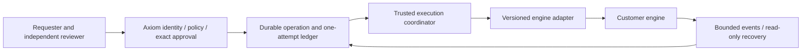

# Engine-independent orchestrator contract proposal

November 2, 2026 · **Internal A9 foundation, planned and unimplemented.**

Companion [dependency inventory](orchestrator-onprem-dependency-inventory.md) supplies exact inspected source hashes. [Master A9](axiom-master-action-plan.md) governs scope and priority: finish core Governance before adapter migration/on-prem deployment. This design grants no provider action, infrastructure spend, installation, permission, activation or release authority. Current Airflow behavior and history remain intact.

## 1. Boundary and alternatives

Recommend a small versioned adapter boundary for engine IO, composed by a server-owned coordinator. Avoid both an Airflow-shaped universal DAG API (cannot honestly express other engines) and handing policy/approval to engine workers (splits authority and permits bypass). A single generic “execute command” endpoint is rejected: it hides unsupported semantics and makes model/configuration data look authoritative.

The engine schedules work; Axiom owns consequential action admission. A workflow submitted to an engine is not a blanket grant to every task it later runs. Every consequential downstream task must enter the current governed fixed responder with its own exact operation/authority or be explicitly refused. Engine retry settings cannot execute a raw provider client around those responders. Full coverage/credential transition/quiescence and deployment original-session/final synchronous freshness remain unresolved core gates; an adapter interface does not close them.

## 2. Identity and envelope (proposed schema `axiom.orchestrator/1`)

Use strict closed schemas, bounded sizes and explicit unsupported results. Tenant comes from paired/server authority, never from model-produced metadata. Logical identity is immutable across reads and recoveries:

| Field | Meaning / validation |
|---|---|
| `schemaVersion` | Exact `axiom.orchestrator/1`; reject unknown major versions before credentials/side effects. Negotiate optional capabilities explicitly, never downgrade silently. |
| `organizationId`, `connectionId`, `connectionRevision` | Captured server scope and current exact engine connection; separate authorization and credential ownership checks remain required. Engine IDs do not establish tenant ownership. |
| `operationId`, `attemptId` | Axiom immutable original operation plus consumed attempt; deterministic external identity derived server-side. Not regenerated by timeout, restart, event receipt or retry. |
| `workflowRef`, `sourceDigest`, `inputDigest` | Engine-neutral reviewed workflow identity/version plus canonical input/source evidence. Engine-specific target binding is a strict typed profile. Mutable names are observations unless an explicitly reviewed immutable profile exists. |
| `engineKind`, `adapterVersion`, `profileVersion` | Server registry-selected engine implementation and capability profile, not a request-supplied module/class/URL. Bind behavior to reviewed code/version. |
| `deadlineAt`, `requestId` | Bounded original deadline and correlation ID. Deadlines never renew in an adapter or serialized callback. Trusted local clock/freshness checks stay private and are repeated at the actual write boundary. |
| Private execution permit | Opaque one-use in-process authority produced only by core current checks, not JSON, a boolean, event, engine token or baseline digest. No secrets/functions in public DTOs or persisted engine receipt. Process restart requires read-only recovery, never reconstructing permission from metadata. |

Suggested limits for review: serialized command ≤64KiB, event ≤16KiB, page ≤100 events and ≤256KiB, opaque engine IDs ≤512 characters and sanitized error detail ≤240. Inputs containing secret references are resolved only inside trusted fixed responders; engine-visible input must not include reusable bearer credentials. These limits are proposed product choices; actual transport constraints need qualification per engine.

## 3. Versioned operations

| Operation | Strict request/response contract | Authority and retry semantics |
|---|---|---|
| `capabilities()` | Returns exact versioned profile: start identity/dedup semantics, status, cancel mode, retry classes, event ordering/cursor scope, retention/readback and observation limits. | Read only, current tenant/connection access. No capability implies Governance coverage. Unknown evidence/feature reports unavailable/unsupported. |
| `validateTarget(target)` | Bounded read-only target/source/inputs compatibility observation with `observedAt`, `expiresAt`, exact binding and exclusions. | No approval/claim/dispatch. Fresh engine source does not prove artifact/health/rollback or current actor permission. |
| `start(command, privatePermit)` | One fixed submission for the exact claimed operation; returns `acknowledged` with bound engine identity, `rejectedBeforeSubmission`, or `unknown`. | Core claims before provider write and performs final checks after all other awaits, with private synchronous expiry/cancel check at dispatch. Lost acknowledgment/5xx/abort after submission started is consumed unknown unless authoritative evidence proves otherwise. Never transparently resubmit. |
| `status(binding)` | Bound observation: normalized state plus native state, observed timestamp, source/cursor/evidence digest and limits. | Read-only current authorized recovery. Do not fabricate terminal state on timeout, not-found, purged history or unsupported mapping. Acknowledged is not successful. |
| `cancel(binding, privatePermit)` | Separate exact cancellation operation and result `requested`, `notSupported`, `alreadyTerminal`, `refused` or `unknown`. | Independently authorize and audit; never bypass claim/approval because “cancel is safer.” Requested cancellation is not completed cancellation, rollback or proof tasks stopped. |
| `retryAssessment(binding)` | Read-only classification: `observationRetry`, `engineInternalTaskRetry`, `newActionRequired`, `notSupported` or `unknown`. | Adapter cannot authorize a new provider submission or reset consumed attempt. Core decides whether a genuinely new exact reviewed operation is permitted; default no resend for unknown. |
| `events(binding,cursor)` | Bounded tenant/run-scoped normalized events, opaque cursor and gap/truncation/retention status. | Events are observations; deduplicate by engine/run/event identity and verify causal binding. Neither callbacks nor event payloads authorize execution. |
| `recover(operationId)` | Core-led read-only lookup using saved exact engine/run identity or a deterministic start identity when acknowledgment was lost. | No start, claim, adoption of another run or attempt reset. Missing readback remains unknown. Late confirmation can append evidence without erasing the original uncertain attempt. |

Do not add a generic `retry()` that simply calls `start()` again. Harmless status/event reads may use bounded backoff under cancellation/deadline. Engine activity retries are safe only when the activity is read-only or re-enters a core ledger that refuses duplicate consumed effects. Even an engine deduplication window does not prove exactly-once external effect.

## 4. State, errors and events

Normalize observations to `accepted`, `queued`, `running`, `succeeded`, `failed`, `cancelRequested`, `cancelled`, `unknown`. Keep `prepared`, `claimed`, `dispatching`, `refused` and `consumed` as **Axiom ledger states**, not engine states. Never infer engine failure from connection loss or permission denial. A completed engine workflow may still contain refused/unknown downstream operations; its receipt cannot promote them to success.

Every observation includes native state and timestamp, exact bound engine identity, completeness and provenance. Monotonic terminal states are not assumed across engine retry/reopen/continue semantics: contradictory observations append an anomaly and require recovery. Event ID plus binding deduplicates; sequence/cursor gaps are explicit. Event delivery may be at-least-once/out-of-order; no “exactly once” claim. Unknown event kinds are retained as bounded opaque metadata only if safe, otherwise omitted with an explicit gap; never interpreted as an action.

Errors use closed codes: `unsupported`, `authorityUnavailable`, `scopeMismatch`, `sourceChanged`, `connectionChanged`, `deadlineExpired`, `cancelledBeforeSubmission`, `providerRejected`, `rateLimited`, `transportUnknown`, `receiptMismatch`, `historyUnavailable`. Preserve whether submission **could have started** privately and in bounded outcome metadata. Do not return raw provider bodies, credentials, SQL errors or model instructions. `rateLimited` is not a resend authorization after a possible write. HTTP success with malformed/wrong-run receipt is unknown, not success.

## 5. Engine capability profiles and preservation

| Dimension | Airflow baseline from current source | Temporal proposal (requires primary-doc/runtime qualification) | Custom-engine requirement |
|---|---|---|---|
| Workflow identity | DAG ID + reviewed source/connection profile; no general immutable DAG source guarantee from name alone. | Explicit namespace/workflow definition/version and task queue binding; do not equate workflow name with immutable code. | Document exact source/version/readback limits. |
| Run identity | Current deterministic scheduled run ID; 409 reconciles exact GET only. Preserve manual-run identity and receipt validation. | Workflow/run identity and reuse policy explicitly bound; continue/retry chains require root identity plus exact segments. Not implemented. | Stable run lookup or explicit unknown recovery limitation. |
| State/tasks | Preserve DAG/run/task identity, nullable logical date, map index/try number, bounded pagination and native states. | Workflow/history/activity/child execution semantics need explicit supported mapping. | Map states and reject ambiguity; no fictional task support. |
| Cancellation | Current inspected Airflow client exposes no generic cancel method. Report unsupported until a safe profile is implemented. | Cancellation request vs termination must be distinct capabilities and distinct governed effects. | Document best-effort/cooperative/immediate limitations. |
| Retry/dedup | Preserve scheduled identity and 409 GET; no adapter resend of unknown action. Engine retry policies remain outside effect permission. | Workflow/activity retry/reuse/reset policies must not duplicate consequential operations. Reset is never read-only recovery. | Declare dedup lifetime and restart/retention limits; idempotency claim needs evidence. |
| Events | Current polling/task observations; no implied streaming event subscription. | Proposed resumable history/event adapter; limits/retention/ordering require tests. | Explicit polling/streaming support and gaps. |

No Temporal behavior above is a claim of an installed client or verified engine guarantee. Use official version-pinned documentation during implementation, then real engine contract tests. The current source-backed Airflow public HTTPS host policy and mutation callbacks must remain effective through migration; internal-host support requires a separately reviewed policy, not globally permitting private networks.

## 6. Transactions, cancellation and rollback ownership

1. Read engine/provider facts outside database locks, bound to exact current connection/source. Expired, missing or partial facts refuse.
2. Core locks organization first, verifies original scope/release/participants/approval/policy/source as applicable, claims and consumes original approval atomically; failure before commit rolls back these together.
3. Obtain engine credential outside locks. Recheck full current authority, original session/deadlines, enrollment/policy and provider facts at final boundary after awaited preparation. Retain private freshness through transaction-return delivery and final synchronous transport handoff. No provider IO under DB locks.
4. Submit once. Cancellation before submission may prevent effect; abort after submission does not prove cancellation and leaves consumed unknown. Track late bounded replies without creating a second attempt or clearing a hold prematurely.
5. Recovery observes exact saved identities. Terminal confirmation must match source/target/operation evidence and current authorized reader scope; identity/role loss preserves history without leaking private details.

Rollback is a separate reviewed operational action/plan with its own policy, source, authority, claims, evidence and unknown recovery. Workflow retries, failure hooks, compensation/sagas and cancellation do not automatically authorize rollback or prove application health. Engines may coordinate an approved rollback, but never manufacture its permission. The approved product semantics for pre-authorized emergency/automatic rollback remain a decision to review; do not infer them from existing template text.

## 7. Required shared contract vectors

Run the identical engine-independent vector IDs against real Airflow and Temporal adapters, plus a documented custom conformance harness. Mocks only establish schema/coordinator behavior, not engine acceptance.

| Vector | Required observation |
|---|---|
| C01 Version/capability mismatch | Refuse before credential/write; unsupported feature clearly reported, no fallback simulation. |
| C02 Scope/connection/source mismatch | Foreign tenant/run/source or changed revision refuses; wrong receipt cannot confirm. |
| C03 Genuine authority | Model recommendations, client flags, copied permits, old approvals, wrong requester and revoked reviewer/session cannot write. Independent genuine human acceptance remains separate. |
| C04 Claim concurrency/rollback | Competing requests yield one committed attempt; pre-claim refusal rolls back approval/events; original approval cannot attach to another operation. |
| C05 Late freshness | Revoke role/session/connection/baseline/policy during each await and across final DB result; expire original proof/deadline with real clock; zero post-refusal writes. |
| C06 Submission uncertainty | Lost reply, abort after accept, malformed receipt, partial stream and delayed response preserve consumed unknown, one submission and zero resend. |
| C07 Dedup/recovery | Scheduled conflict readback validates exact run; missing/purged/wrong run remains unknown. Restart and double recovery never submit. |
| C08 Engine task retry | Replayed/duplicated task reaches effect ledger and cannot repeat consumed write; engine success cannot override refused/unknown effect. |
| C09 Cancellation | Unsupported reports so; cooperative request is distinct from terminal cancellation; separate permission/claim/audit; cancel loss is unknown. |
| C10 Event disorder | Duplicate/out-of-order/gap/replay/foreign-run events cannot grant authority or regress history silently; bounded cursor recovery works. |
| C11 Failures/recovery | Engine/DB/time/credential/audit outage, process crash and backup restore preserve ownership/history and refuse unsafe new work. |
| C12 Airflow compatibility | Existing list/validate/manual/scheduled run/task observation, logical-date-null handling, deterministic run ID, 409 exact GET and scheduled concurrent-edit preservation unchanged. |
| C13 Offline egress | Actual governed internal deployment with internet disabled; local identity/entitlement/AI optionality/keys/audit/DB/engine/target work, forbidden calls fail closed. |
| C14 Upgrade/custom | Version skew, schema migration, unsupported downgrade and custom adapter conformance produce explicit compatible/refused results, never silent reinterpretation. |

## 8. Offline deployment acceptance and decisions

A real acceptance environment must include customer-controlled application/API, local IdP/session service, non-bypassed offline entitlement, policy/approval/audit/database services, engine, trusted clock/key custody, internal source/target/artifact supply, and local inference if used. An offline web page, isolated Postgres test, mocked provider, fake reviewer or started container is insufficient.

Capture: exact signed bundle/image/SBOM/model hashes and import provenance; clean installation; two genuine independent identities; exact plan/baseline/approval; one current governed internal deployment; target readback and application validation separate from submission acknowledgment; explicit rollback/recovery exercise; denied-egress DNS/network evidence; audit integrity and backup/restore; upgrade compatibility; session/entitlement/key expiry/revocation/outage behavior. Redact secrets/tenant data before sharing evidence. No environment or human acceptance is supplied here.

Decisions before implementation: initial deployment scale/HA/support matrix; engine priority and source-binding profiles; local SSO/entitlement/time/keys; dedup/event-retention contract; exact cancellation/rollback permissions; local model/provider selection; data retention/diagnostics; customer internal-host trust policy; signed adapter distribution and compatibility; migration of existing Airflow identities/history without resubmission. Recommend server-registered built-in adapters first, reviewed external custom adapter process later. Arbitrary uploaded code/plugins inside the authority process are out of this initial proposal.

Complete core Governance first, then implement adapter seam behind unchanged safe defaults, pass common tests and Airflow regression acceptance, then real isolated-engine and offline installation acceptance. No new feature flag, migration, infrastructure, cloud license bypass, private-host exception or production activation is authorized by this design.
