# Product trust boundaries — finite source threat model

Internal draft, November 5, 2026. Source baseline `ce754fb4baea8aba8554537e3b9fbef54a4e4cdf`; exact whole-file and selected-range hashes for 33 files are in [source bindings](product-trust-boundary-sources.json). Source bytes are not running identity, deployed configuration or independent assurance. This is a broader product assessment, not an exhaustive application threat model or a security certification.

## Customer problem and scope

Before connecting a repository or sharing context with AI, a customer needs to know which identity, permissions, data, money and execution controls actually apply. For example: a legitimate user may approve a change, lose their permission, and later try to execute it; a repository document may instruct an AI to reveal a secret; a lost provider response may tempt an operator to repeat a completed write. The required outcome is a current, exact, tenant-scoped decision and an honest result, not a reassuring connected badge.

This source-only unit maps those threats to existing mechanisms and missing acceptance. It changes no code, permission, configuration, availability, credential, policy, production route or spending authority. Components below are ownership areas, not verified deployment principals. Existing bootstrap models remain preserved: [current bootstrap snapshot](current-bootstrap-threat-model.md), [historical runtime model](runtime-trust-boundary-threat-model.md). They cover a narrower runtime chain; this document does not restamp their historical evidence.

## Assets, actors and assumptions

Protect tenant repository/source content, personal/customer messages and uploaded context; browser/device sessions and accepted roles; provider connections, private signing/encryption material and reusable tokens; exact proposals, independent decisions and execution claims; customer/run budgets and unresolved cost exposure; original provider-attempt/unknown-outcome history and audit data; installer/source/package integrity; and public versus internal support knowledge.

Consider an unauthenticated caller; a malicious or revoked member; an attacker holding a stolen session or provider token; hostile repository/document/model content; a compromised dependency, build account or provider; and an operator making a scope, configuration or recovery mistake. Public-bot ownership/publication semantics must be established rather than assuming every bot is either private or freely publishable.

The reviewed local-runtime designs assume trusted host kernel/platform services and trusted native code in the intended process. They do not establish protection against a malicious host administrator/kernel or malicious code already in that process. Cloud-provider retention/training terms, actual deployed grants, fleet history, backup access, local-model behavior and disconnected operation remain separate evidence requirements. Neither a source digest nor this model creates custody or execution authority.

## Data-flow families

```mermaid
flowchart LR
  User[Customer or operator] --> Identity[Browser / paired desktop identity]
  Identity --> Scope[Current workspace and operation scope]
  Scope --> Context[Selected repository / provider / document context]
  Context --> AI[Configured AI path]
  AI --> Proposal[Untrusted suggestion or exact saved proposal]
  Proposal --> Review[Workflow-specific independent decision]
  Review --> Admission[Current claim / policy / budget / source checks]
  Admission --> Adapter[Narrow execution adapter]
  Adapter --> Provider[External provider]
  Provider --> Outcome[Observed outcome / durable unknown history]
  Outcome --> Recovery[Read-only inspection and governed recovery]
  Identity --> Stores[Tenant records / encrypted credentials / audit]
```

This is a map of families, not a claim every request traverses one implemented chain. Read-only, generic AI, workforce, legacy bot, release and connected-app paths differ. Complete registered execution coverage and the private custodian chain are not qualified. The AI is not the authority deciding its own approval; observation and a model-written success statement are different evidence classes.

## Finite threat and acceptance matrix

Source keys resolve to exact paths/ranges in the manifest. Controls are observed source behavior only. An open gate is not automatically a demonstrated exploit or a statement about live customer data.

| ID / boundary | Threat and observed mechanism | Missing evidence / required acceptance |
| --- | --- | --- |
| T01 Browser identity → workspace (`identity`) | A member chooses another workspace or retains a revoked selection. Current context derives roles from accepted current membership; selection is preference, not a grant. | Inventory actual route usage and qualify multi-workspace, revoked-member and failure behavior across reads, writes, caches, jobs and exports. One resolver is not global tenant coverage. |
| T02 Device token → current actor (`device-token`, `device-session`) | A stolen, forged, expired or overly privileged token is presented. HMAC comparison is constant-time; the resolver separately checks durable active session, current membership/capabilities and route options, distinguishing API keys from role-only access. | Exact-build pairing/storage, logout, rotation, replay, recovery and revocation journeys; verify all route options and real device/session behavior. A valid signature alone is not current authorization. |
| T03 Query → tenant records (`isolation`) | IDOR/cross-tenant record references. Helpers add tenant filters, compare record ownership and attempt scoped audit reporting. | All query/cache/job/export/admin call-site coverage and actual two-tenant negative journeys. A helper comment saying every query is not proof that every caller uses it. |
| T04 OAuth callback → connection (`oauth`, `connection-authority`) | State replay, account/workspace switch or a stale administrator completes consent. The selected Outlook path uses one-use actor/org/redirect-bound state, encrypted PKCE context, scope validation and current actor/revision checks with readback. | Provider/browser replay, revoke, switch and unknown-exchange recovery acceptance. This one provider cannot qualify all OAuth implementations. |
| T05 Stored ciphertext → provider secret (`vault`, `vault-crypto`, `connection-authority`) | Database disclosure or swapping ciphertext between connections. Scoped envelopes use random-IV AES-256-GCM with organization/provider/connection context. Legacy envelopes remain distinct. | All caller/envelope inventory, migration decisions, effective key custody/rotation and backup/logging/access evidence. Merely finding legacy code does not establish an active leak; encryption does not protect against an actor holding its key. |
| T06 GitHub signer → installation token (`github-auth`) | Wrong installation/repository/profile or stale cached token reuse. Scoped/profile cache keys, exact read-grant validation and epoch/cancellation checks exist. | Current installation ownership/caller composition, actual grants/revocation/rotation and outstanding-token lifetime qualification. Separately classify legacy unscoped-read support. |
| T07 Repository context → model (`coding-context`, `repo-context`, `prompt`) | Hostile repository/operator text is treated as instructions or contains confidential data. The coding path re-resolves tenant/repository credentials for file access; messages contain selected context. | Explicit data classification, minimization/redaction and adversarial prompt-injection/exfiltration evaluations across every caller. Prompt delimiters and source credentials do not make text trustworthy or prove provider retention. |
| T08 Admitted text → configured model (`ai-policy`, `ai-admission`, `ai-manager`) | A disabled policy, changed model or reused admission capability reaches inference. The reviewed path locks current organization policy, binds an exact model and consumes a private capability once, with policy checks at the manager boundary. | Full caller inventory and real composed revocation/expiry/cancellation cases. Logical refusal does not retract bytes already transmitted; complete product-wide admission is not established. |
| T09 Coding request → money (`coding-reservation`, `quote`, `run-budget`) | Concurrent/repeated work overspends or unknown charges become zero. Reservations bind org/run/stage/generation/actor and retain dispatch-unknown exposure; quotes bind payload/options/expiry. | Qualified actual rates, fee/routing/output bounds, settlement/invoice reconciliation, adversarial concurrency and quality-adjusted cost measurements. Synthetic pricing is not billable qualification or competitor token savings. |
| T10 Model output → write permission (`approved-code`, `coding-context`) | Model text or a recommendation is adopted as human authority. The selected coding path binds an approved artifact/run/actor/current member, two-step decision identities, exact digest and separately resolved write authority. | Real independent human decisions and complete current execution/credential/claim/final-send/fleet coverage for every operation. These selected source mechanisms do not activate Governance or qualify other tools. |
| T11 Legacy bot chat → model/storage (`legacy-chat`, `legacy-orchestrator`, `legacy-gateway`, `ai-manager`, `edge`) | A legacy caller is mistaken for the newer admitted path. The route loads bot/source/user data by bot ID, checks an IP rate limit/message allowance, calls the legacy orchestrator/manager and increments the counter afterward. | Establish intended public-bot ownership/publication, actual reachability, tenant/account policy, metering and concurrent-cost contracts. Then run a synthetic route-to-SDK diagnostic. Source inspection establishes a different call family, not a confirmed production bypass/leak; do not silently disable or retrofit it without the reviewed behavior decision. |
| T12 Prompt/response → logs (`ai-logs`) | Secrets or identifiers appear in previews/correlation metadata. Selected instrumentation redacts known patterns, bounds previews and checks token/identifier shape. | General PII/DLP, all logging paths, actual access/retention/deletion and failed-transport data handling. Pattern redaction is not a zero-leak guarantee. |
| T13 Release metadata → installer trust (`release-metadata`, `download`) | A release badge/URL is treated as proof of binary trust. Resolver selects published non-draft/non-prerelease records, explicit body signing markers and runtime readiness. | Body markers and reachable URLs are metadata, not local cryptographic signature verification or clean-host acceptance. Require exact reviewed publisher/source/assets/signatures, real signing/notarization and genuine protected publication; retain unresolved Windows trust. No new download/publication check was run here. |
| T14 Event → audit/history (`audit`, `legacy-audit`) | A caller assumes audit persistence or global redaction after an action. Canonical record preparation scopes/redacts detail, but its record function returns with no store and catches append failure; the legacy logger is likewise best effort. | Per-action classification of mandatory transactional operation history versus diagnostic audit, persistence failure/recovery/tamper/retention/export tests and actual wiring. Do not infer all sensitive actions funnel through one helper or confuse best-effort events with durable execution claims. No new audit-loss exploit was exercised. |
| T15 Documentation → customer answer (`knowledge`, `knowledge-cli`) | Internal, stale or unreviewed material is exposed as an approved answer. Source/evidence/version/media hashes and metadata eligibility checks exist; selected output is still simulation-only/customer-ineligible and ordinary CLI refuses. | Genuine editorial/media/released-version and delivery authority, classification/export review, custody and actual retrieval evaluations. Hash-bound text/citations and finite credential heuristics do not prove confidentiality or activate customer support. |
| T16 Edge/UI → security assurance (`edge`, `public-security`, `ai-illustration`, `security-docs`) | CORS, headers, a connected label or a diagram is mistaken for authentication, no egress or certification. Source has origin/header/navigation controls and explicit public limits. | Endpoint authentication/current authority, deployment-specific CSP/egress review and independent assessment. Selected Bot diagrams are not an exhaustive egress inventory; audit/control mappings are not SOC 2/ISO/HIPAA/CMMC/FedRAMP assurance. |

## Decisions and next acceptance work

1. **Preserve A2 priority.** The current exact Stage A artifact packet remains unexecuted pending its existing specific decision. Actual principal, signed loader, private resource custody, SAME-consumer, legacy/fleet withdrawal and complete execution coverage gates remain mandatory. This document supplies none of them and authorizes no experiment.
2. **Qualify T11 before claiming universal AI admission.** First bind the legacy route's intended owner/publication/commercial contract and follow its actual call graph in an isolated synthetic diagnostic. Keep source observation, reproduced behavior and live acceptance separate. Any runtime availability/admission change needs its applicable reviewed authorization.
3. **Inventory T03/T05/T14 across actual callers.** Distinguish tenant ownership, encrypted-envelope usage, per-action transactional history and best-effort telemetry. Existing records and unknown effects must stay intact; no SQL repair, migration, grant or secret access follows from this task.
4. **Preserve A3 and release boundaries.** The written unknown ServiceNow note must never be resent/reset/renewed or given a descendant. Genuine fresh observation/native approval/terminal policy/exact closure remain open. A1 protected release and deferred A5 Windows/Store acceptance remain separate from metadata and this source assessment.
5. **Keep assurance evidence-based.** Obtain deployment-specific data-flow/retention/egress, incident/backup/restore, independent penetration/remediation and authentic customer journeys under separately authorized conditions. No absolute security or token-efficiency promise; A9 air-gap/on-prem and C1–C6 future operations remain unqualified.

Example acceptance vectors are proposals, not tests run by this unit: revoked member between read/claim/final send; cross-tenant source ID and ciphertext swap; hostile repository text seeking unrelated context; duplicate/concurrent and dropped-response AI cost; legacy public/private bot classification; lost provider response with read-only recovery and no resend; missing audit store versus required operation history; substituted/stale installer metadata; stale/internal support article versus a released public answer. Each needs the right actual authority/storage/runtime boundaries and both positive and negative controls.

## Later bounded diagnostic — T11 remains unqualified

The [selected legacy-bot diagnostic](../../recovery/2026-11-05/legacy-bot-chat-diagnostic/README.md) subsequently passed four synthetic characterization/control cases using the actual selected call graph and mocked SDK/storage. It confirms the distinct unattributed legacy call family, not a production leak, real charge or universal policy bypass. Public embedding intent is established by source; publication/owner/accounting decisions remain required. The reviewed local containment proposal changes availability and has not been implemented or approved. This follow-up satisfies the proposed synthetic diagnostic step only; it does not satisfy T11's broader acceptance gates or change the33-runtime-source baseline.

## Verification, recovery and cost

Three specialist source inventories and root review supplied this finite map. The accompanying manifest pins files/ranges; it does not validate runtime call coverage or security properties. No programs under qualification, OS/Security/Keychain operations, database/provider/model calls, scans, installs, credentials, grants, builds or deployments were run. No new dependency or spending. Documentation can be reverted without changing runtime behavior; retain historical models, evidence and the original master scope. Independent assessment and the complete A7 security program remain open, as do all21 master parents.
