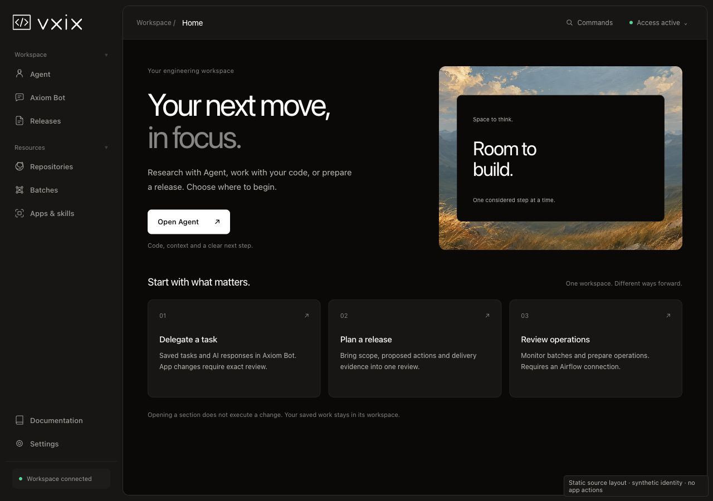
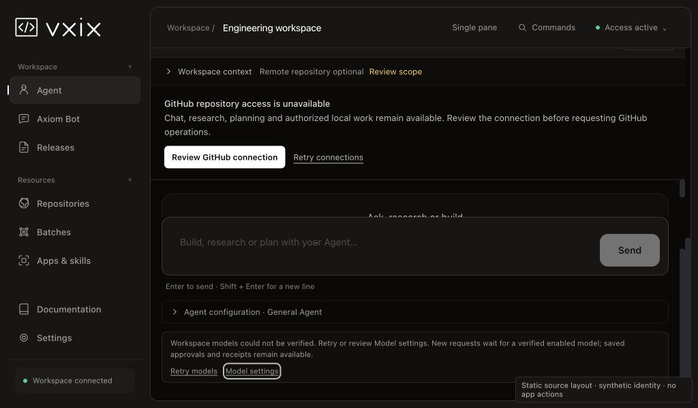
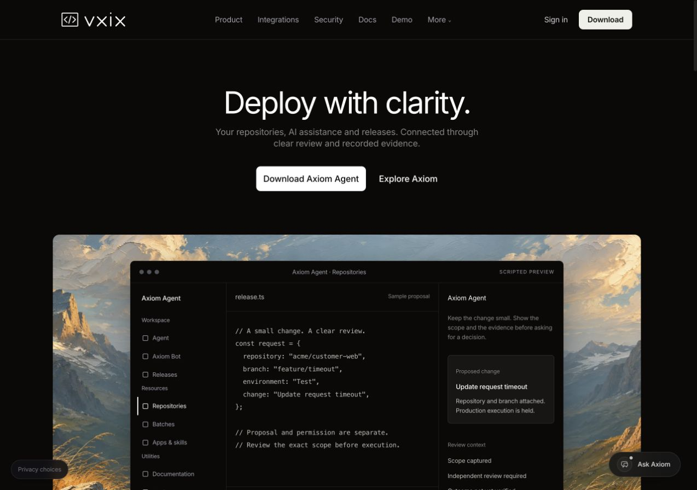

# vxix website and desktop frontend release candidate

The owner-selected Exact-inspired visual system is applied across the public website and actual desktop frontend. An original boxed-code vxix wordmark appears in top-left navigation/entry surfaces; product/legal identity remains Axiom Agent/Vision XIX Labs. Static hero and original painted framing replace the active vortex; direct story/scenario selectors replace player rows. Public pages use warm black/charcoal/neutral hierarchy and native scroll depth with short-window/reduced-motion/large-text fallbacks. Desktop now has an inset workspace, quieter navigation/toolbar, redesigned Home and shared operational hierarchy.

Candidate0.1.23 aligns package/lock/Tauri/Cargo identities without dependency changes. A frontend build and website deployment do not publish or install a desktop binary. Authentication, access, permissions, action callbacks and meaningful desktop statuses remain unchanged. Public statuses retain explicit verdict text and distinct icons in the selected neutral palette. Governance remains incomplete/disabled; payments remain off.

## Verification

- Full pinned Node24 suite:19591passed,1expectedfailure,1144explicitlyskipped; root/desktop strict types and36PythonCLI checks pass. Unsupported Node25 refusal and stale old-design test expectations were diagnosed without weakening security gates.
- Joint website/desktop build accepted5994b682…19f5f7.54public route/viewport observations and52desktop geometry checks, representative screenshots and website menu/pointer/disclosure/motion/text observations recorded.
- Real short-split focus overflow was reproduced in the browser; one local positioning declaration fixed it. Desktop-only build accepted e15e4411…fd109. The same compiled keyboard path passes at600/900px in both themes, with outer window scroll0 and visible toolbar.12additional workspace geometry checks pass. Original website files were reconstructed exactly; new runtime-generated preview cache was excluded, no second website build. Both previews/tabs/overrides cleaned up normally.
- Independent whole-source, source-fix, build and artifact reviews found no blocking defects. Current product hashes remain equal to the corrected accepted build; see PRODUCT-SOURCE-IDENTITY.json.

The screenshots below are static component layouts with synthetic identity/empty or unavailable services, using compiled desktop CSS. They establish appearance and browser scrolling, not native application actions, installed WebKit compatibility, real credentials, provider outcomes, signing or customer acceptance. Full master/native/distribution/performance/Governance qualification and the separately recorded production-runtime health issue remain open.

## Authorized next steps

One coherent PR, all required green checks and normal merge; then one qualified Vercel production build/deployment after exact target/source/schema compatibility checks. No migrations are introduced by this visual source. Vercel automatic Git deployments remain disabled. Verify deployed runtime health before promotion, preserving the existing unresolved health evidence rather than claiming it was repaired by frontend work. Resume remaining master work starting with Governance; do not enable it from visual/CI evidence.
